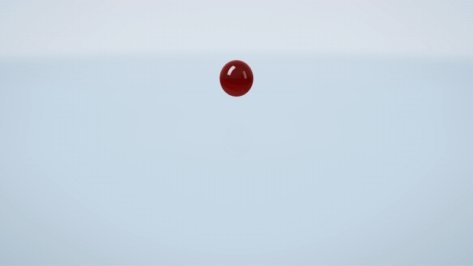
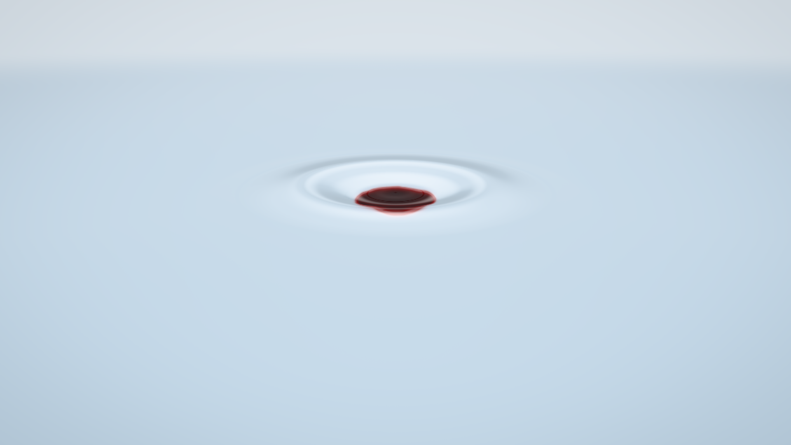
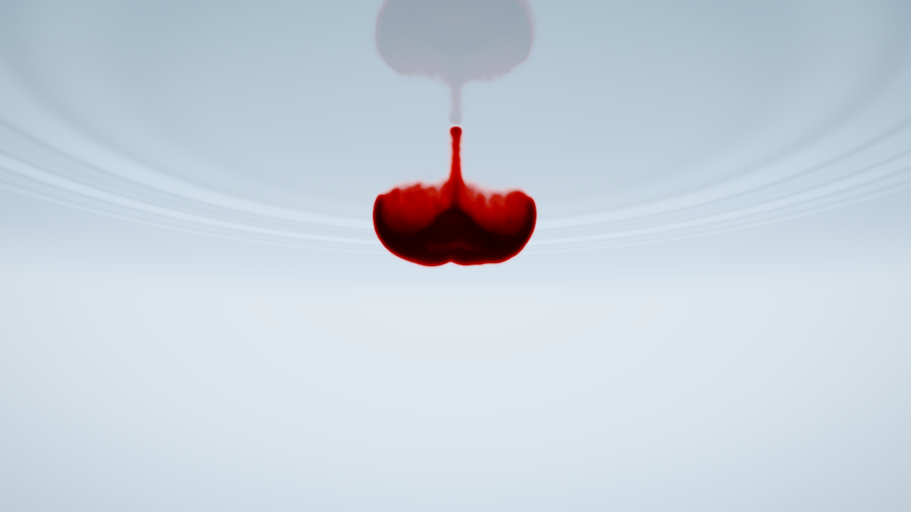
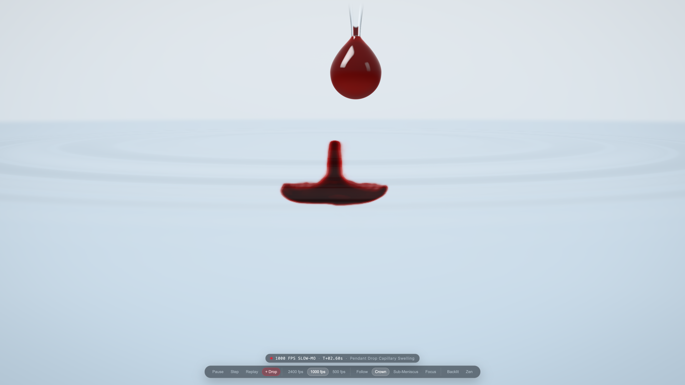
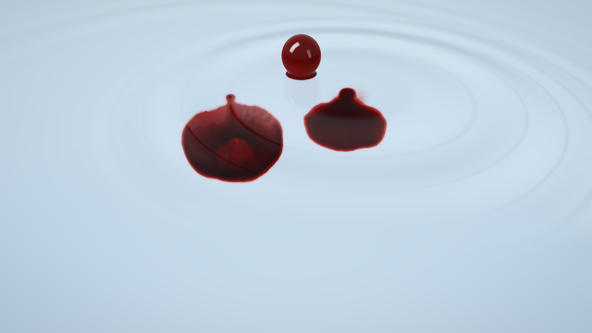
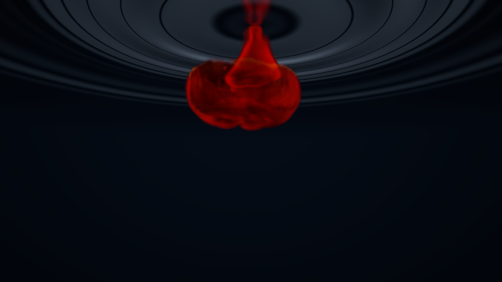
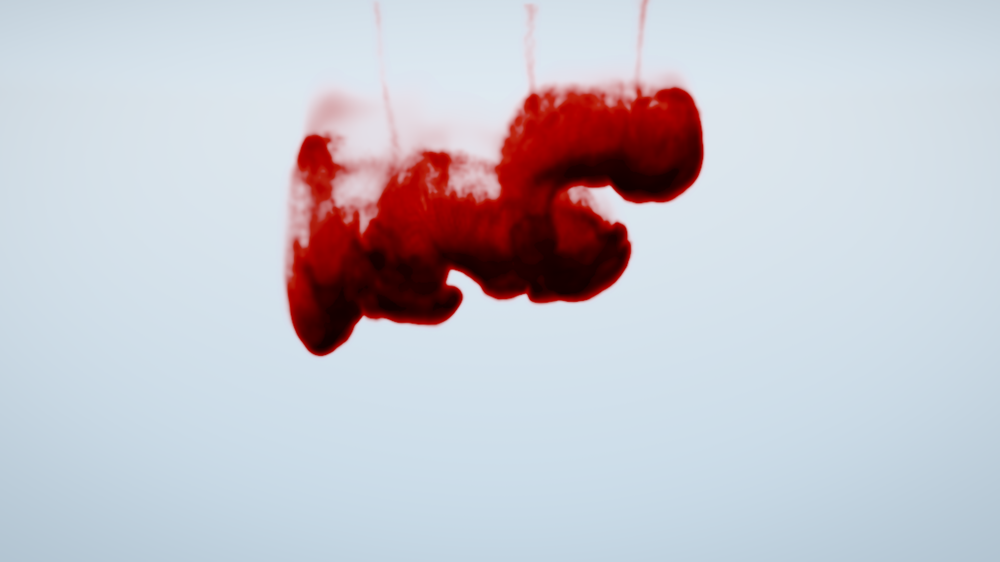

# Drop of Blood



Live at **[drop-of-blood.andrewvoirol.com](https://drop-of-blood.andrewvoirol.com)** — real-time `1000 fps` slow-motion fluid and optical WebGPU simulation of whole blood drops releasing from a borosilicate Pasteur pipette into calm water, driving dispersive capillary–gravity wave trains, rolling into Thomson–Newall vortex rings, leapfrogging through multi-drop wakes, and lysing into ruby-rose plasma veils.

## Quick Start

Requires Node.js 22+ and a WebGPU-enabled browser (Chrome 113+, Edge 113+, or Safari 18+).

```bash
git clone https://github.com/AndrewVoirol/drop-of-blood.git
cd drop-of-blood
npm install
npm run dev
```

## Single-Drop vs. Multi-Drop States

| Surface Impact & 512² Capillary Precursors | Sub-Meniscus TIR & Vortex Torus |
| :---: | :---: |
|  |  |

| Second Pipette Drop Over Active Plume + HUD | 3-Drop Capillary Wave Interference |
| :---: | :---: |
|  |  |

| Dark-Field Multi-Drop Wake Slipstream | Solenoidal Rayleigh–Taylor Curtains & Hemolysis |
| :---: | :---: |
|  |  |

## How It Works

Click anywhere on the water to squeeze a brisk `3.5 mm` drop from the Pasteur pipette, or **press and hold** (`0.16–2.2 s`) to swell a larger Young–Laplace pendant drop ($V \propto t$) before releasing it. Drop a second or third bead alongside or directly above an active plume to watch circular capillary–gravity wave packets cross cleanly on the meniscus while trailing drops slipstream into the wake of earlier vortex rings and leapfrog through their cores. Drag to orbit, `Shift + drag` (or two-finger drag) to pan in 3D, scroll down to `0.24 m` macro distance, press `F` to lock **Focus** onto individual plumes, `Space` + `.` to pause into `16×` golden-ratio SSAA single-step inspection, `L` to switch **Backlit** vs. **Dark Field** studio lighting, or `H` for **Zen** mode.

Under the hood, each frame submits a zero-allocation WebGPU compute and optical pipeline: a `512 × 512` unitary 2D Stockham FFT capillary–gravity solver ($\omega^2 = gk + (\sigma/\rho)k^3$, $\Delta x = 6.25\text{ mm}$) evolves dispersive precursor ripples across a radial Rayleigh absorber; a `192 × 256 × 192` staggered MAC incompressible Navier–Stokes solver with a 3-level geometric Multigrid V-cycle, shear-thinning Casson blood rheology, and `393,216` Lagrangian erythrocyte parcels drives oblate vortex roll-up, solenoidal ($\nabla \cdot \mathbf{u}_{\text{sub}} \equiv 0$) Rayleigh–Taylor breakup, osmotic hemolysis, and floor *rouleaux* settling; and a two-stage volumetric + `1:1` Retina raytracer evaluates $C^2$-cubic B-spline density gradients, `380–720 nm` Prahl $\text{HbO}_2$/$\text{dHb}$ spectral Beer–Lambert extinction with Duysens discrete-cell sieve flattening, underside Total Internal Reflection, and automatic Apple Silicon XDR `rgba16float` extended-sRGB headroom.

## Tech Stack

| Layer | Technology |
| :--- | :--- |
| Build & Bundler | Vite 8 (Rolldown) |
| Language | TypeScript 7 (`tsgo` strict) |
| GPU Compute & Optics | Raw WebGPU + 31 WGSL Shaders (zero runtime dependencies) |
| Verification & Lint | Vitest + `wgsl_reflect` AST Linter + Headless Metal CDP Gate |
